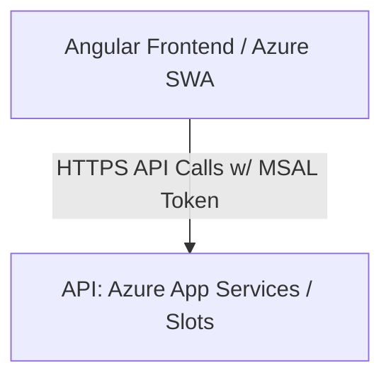
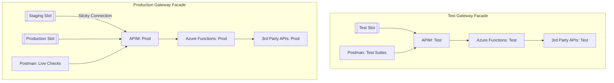
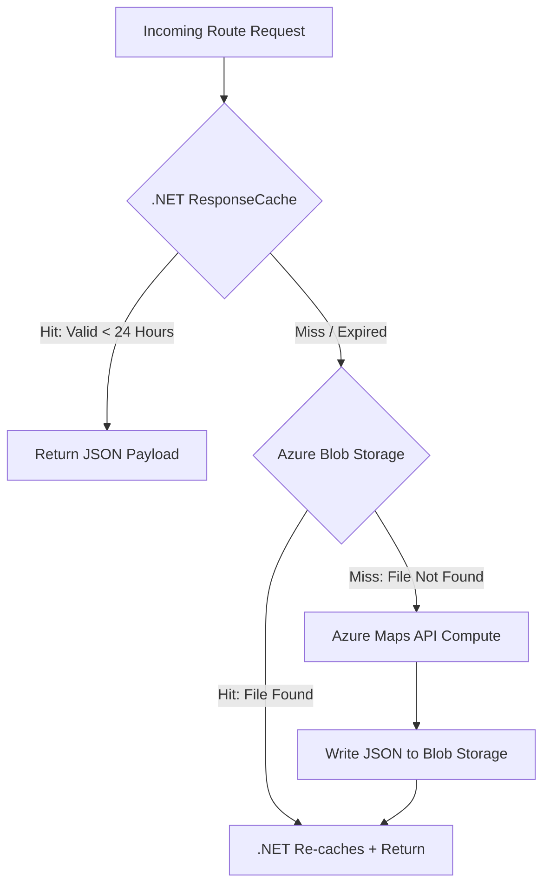

# Freight Logistics Architecture
### Systems Modernization & Architectural Optimization
**Presenter:** Adrian Forbes (Team Lead, Full Stack Engineering) | Solution Architect Senior

---

## 1. System Overview & Core Requirements

* **Domain:** Mission-critical freight logistics web application
* **Hosting Model:** Fully managed, cloud-native Azure ecosystem
* **Service Level Objectives (SLOs):**
    * Critical North America 14-hour business hours uptime
    * Immediate rollback response for release edge case scenarios
    * Perceived page load times (eg. "Loading...") under 5 seconds with sub-second latency for component asynchronous requests
* **Recovery Time Objective (RTO):** Maximum 30 minutes allowable downtime for restoring operations after a disruption or outage
* **Capacity Allocation Constraints:** Acting as both Full Stack Software Engineer and Solution Architect
    * **High Priority (90%)** Ongoing development release cycle and tier-2 support
    * **Medium Priority (10%)** Architectural enhancements, technology upgrades (Angular and .Net), mitigating technical debt (eg. VB.Net repositories)

---

## 2. Legacy Architectural Pain Points

* **High-Risk Promotions:** Had only a Test and Production environment. Slot swaps were executed *between* Test and Production directly, with no Staging layer for validation.
* **Monolithic Complications:**
    * **Combined UI and API Deployment Package:** Build/publish cycles took at least 10 minutes and would sometimes fail, causing additional development downtime.
    * **3rd-party API Lag:** API calls were fired straight from the application runtime, stalling user interfaces when external systems lagged.
* **Severe Memory & Database Pressure:**
    * **No Caching Layer:** Typeaheads relied on a massive, preloaded city-list object held entirely in API server memory. Heavy Order/Loads and Tracking pages were slow to load from many API requests for lookup table data.
    * **Storage Exhaustion:** Multi-city GPS coordinate paths sat inside a bloated database table. No partitioning on `AuditLogs` resulted in query timeouts.
    * **No Storage Offloading:** No document management engine or file storage was utilized.

---

## 3. Legacy Topology

 ```mermaid
graph LR
    subgraph Environment [App Service / Hosting Environment]
        subgraph Test [Test Slot]
            A[Monolith UI / API]
        end

        subgraph Prod [Production Slot]
            B[Monolith UI / API]
        end
        
        %% Swap Action
        A <--> |Deployment Swap| B
    end

    subgraph Data [Data Tier]
        DB_Test[(Azure SQL: Test)]
        DB_Prod[(Azure SQL: Prod)]
    end

    %% Database Connections
    A ---> DB_Test
    B ---> DB_Prod
```
---

## 4. Decoupled Multi-Environment Topology

 ```mermaid
graph TD
    subgraph Frontend Layer [Direct CDN Publishing]
        SWA_Test[Angular Test SWA]
        SWA_Stag[Angular Staging SWA]
        SWA_Prod[Angular Prod SWA]
    end

    subgraph Backend App Service Plan [Sequential Swap Chain]
        SWA_Test -->|Direct UI-to-API| Slot_Test[[Test Slot]]
        SWA_Stag -->|Direct UI-to-API| Slot_Stag[[Staging Slot]]
        SWA_Prod -->|Direct UI-to-API| Slot_Prod[[Production Slot]]
        
        Slot_Test <-->|1. PROMOTION SWAP| Slot_Stag
        Slot_Stag <-->|2. DEPLOYMENT SWAP| Slot_Prod
    end

    subgraph Data & Storage Isolation Tier
        Slot_Test --> DB_Test[(Azure SQL: Test)]
        Slot_Test --> Blob_Test[(Blob Storage: Test Container)]
        
        Slot_Stag -->|Sticky Setting| DB_Prod_Main[(Azure SQL: Prod)]
        Slot_Prod -->|Sticky Setting| DB_Prod_Main
        
        Slot_Stag -->|Sticky Setting| Blob_Prod[(Blob Storage: Prod Container)]
        Slot_Prod -->|Sticky Setting| Blob_Prod
    end
```

---

## 5. Compute State & Schema Continuity

* **Frontend Delivery:** Angular static web assets are directly published to their respective Azure SWA instances. No slot switches are performed on the CDN edge.
* **Backend Zero-Downtime Swaps:** API code is published to the **Test Slot** and fully warmed up via the root runtime path, followed by sequential slot swaps to **Staging** and then to **Production** with zero traffic interruption.
* **Database Drift Logic:** Employing an **Expand and Contract pattern**. Schema migrations are pushed *before* the slot swap occurs using backward-compatible, non-breaking mutations.

---

## 5. Existing End-to-End Enterprise Identity & Security

* **Frontend Authentication:** The Angular UI integrates **MSAL (Microsoft Authentication Library)** to handle secure user authentication directly via Microsoft login.
* **The Token Lifecycle:**
    * MSAL acquires and automatically caches cryptographic JWT Access Tokens in the browser.
    * An internal HTTP interceptor attaches the token to all direct backend API requests.
* **Backend Authorization:** The `.NET Web API` validates the incoming Bearer token claims against **Azure Entra ID** to enforce granular Role-Based Access Control (RBAC).



---

## 6. Third-Party API Communication & Dual-Facade Architecture



---

## 7. Database Tuning & Cloud Cost Controls

To prevent unbounded data growth and optimize compute costs within Azure SQL, the database tuning strategy deploys two lifecycle architectures:

* **Horizontal Table Partitioning:**
    * High-volume `AuditLogs` are partitioned by **date ranges**.
    * Query engines leverage **partition pruning** to completely bypass irrelevant data blocks.
    * Result: Sub-second user access to historic compliance trails.
* **Time-Bounded Log Retention:**
    * System telemetry and API `UsageLogs` are capped on a rolling retention window.
    * An automated background process continuously purges aged records.
    * Result: Hard-caps database file size growth and flattens Azure storage expenses.

---

## 8. Comprehensive 4-Tier Caching Topology

To aggressively maximize performance, caching layers are partitioned by data change frequency:

| Tier | Caching Engine | Targeted Data Payload | Lifespan / Isolation Strategy |
| :--- | :--- | :--- | :--- |
| **Tier 1** | `.NET ResponseCache` | Long-term Static Lookups | Completely local in-memory; zero network hops. |
| **Tier 2** | `Azure Cache for Redis` | High-frequency Typeahead Search | Prefixed key spaces (`prod:typeahead:*`). |
| **Tier 3** | Hybrid Response/Blob | Multi-City Route GPS Data | 24-Hour cache fallback to JSON objects. |
| **Tier 4** | Azure Blob Storage | Historical Document Archive | Persisted behind authenticated API proxies. |

---

## 9. Tiered Route Resolution Pipeline

When a user requests multi-city route GPS coordinates, the Web API processes the request through a strict **3-tier failover lifecycle**:



---

## 10. Architectural Performance Gain

| Architecture Optimization | User/Developer Experience Reference | Baseline Range | Optimized Range | Performance Gain |
| :--- | :--- | :--- | :--- | :--- |
| **Tier 1 `.NET ResponseCache`** | Heavy Order/Loads Page | 10sec - 15sec | 2sec - 3sec | 5x Speedup |
| **Tier 2 Azure for Redis Cache** | City Dropdown Typeahead (eg. Ch, Chi, Chic) | 1sec - 30sec | 110ms - 120ms (warm-up) & 48ms - 51ms (cached) | 9x Speedup |
| **Tier 3 Hybrid Response/Blob** | Tracking Map Multi-City Route | 3sec - 5sec | 400ms - 500ms (warm-up) & 9ms - 10ms (cached) | 30x Speedup |
| **Third-Party Integration** | Push Order & Load Updates on Save | 2sec - timeout | 0sec | Offloaded |
| **Table Partitioning** | Audit Trail View | 30sec - timeout | 1sec - 3sec | 30x Speedup |
| **Decoupled Multi-Environment** | Build & Publish UI to Test | 10min - 30min (periodic failure multiplier) | 1min - 2min | 10x Speedup (20x for one failure) |
| **Decoupled Multi-Environment** | Build & Publish API to Test | 10min - 30min (periodic failure multiplier) | 2min - 3min | 5x Speedup (10x for one failure) |

---

## 11. Service Cost Line Items

| Service | Change in Tier/Scale/Usage | Architectural Cost ($ / mo) |
| :--- | :--- | ---: |
| **Application Service** | Service Plan reduced: Premium v3 P2v3 to P1v3 | ($255) |
| **Static Web App** | New Service Plan: Standard | $9 |
| **Azure Functions Service** | New Service Plan: Premium v3 P0v3 | $127 |
| **API Management Service** | New Service | $49 |
| **SQL Azure - Prod** | Compute/Storage: **Capped** at 1600 DTU/750GB | $0 |
| **SQL Azure - Test** | Compute/Storage: 1600 DTU/750GB to 400 DTU/250GB | ($1817) |
| **Azure Cache for Redis** | New Service Plan: Balanced B1 | $51 |
| **Azure Maps** | Reduced API calls | ($100) |
| **Total** |  | ($1936) |

---

## 12. Financial Executive Summary

| Financial Metric | Project Optimization Value |
| :--- | ---: |
| **Baseline Architectural Cost (4-month average)** | $7,476 / mo |
| **Post-Implementation Cost (4-month average)** | $5,540 / mo |
| **Cost Reductions Achieved (Monthly)** | $1,936 / mo |
| **Empirical Percentage Reduction** | 25.9 % |
| **Annualized Run-Rate Savings:** | $23,232 / yr |

### **Legacy Cost Projection:** Prior to optimization, the baseline architecture cost grew from $5,400 to $7,000 over the previous 9 months. Left unchecked, the monthly cost projection was estimated to cross $9,000 within the next 12 months.

### **Future Cost Projection:** All services remain at a steady non-growth level. The Azure SQL production database sits at 177gb capacity with 750gb allocated. Growth allowance is at least two years with minimal change in cost.

---

## 13. Conclusion & Verification Plan

### **User Experience:** Feedback was gathered for web application performance confirmation and data validity
* Page load times ("it runs faster")
* Less reported "need to reload the page" experience
* Speed of dropdown typeaheads
* Map routing speed
* Audit log access speed and no longer avoiding that area
* Third-party API call data validity and speed to save related data

### **Monitoring:**
* **Application Logs:** Reviewing logs continued as before
* **Azure Metrics:** Charts were added to a `Cost Metrics` dashboard for tracking and verifying stability and costs
    * **Daily Costs:** Stacked service costs per day
    * **App Services (split Test/Prod):** CPU, memory, I/O, process, response time, and requests
    * **Azure SQL Databases (split Test/Prod):** DTU, data space, I/O, and sessions
    * **Redis Cache** CPU and memory
    * **Azure Functions (split Test/Prod):** CPU and memory

---

## 14. Q&A and Engineering Appendix

* Open for peer review regarding architectural topology, schema continuity, caching boundaries, and third-party API isolation.
* **Deep dives available in repository:**
    * [Appendix A: Architectual Trade-off Matrix](technical-spec.md)
    * [Appendix B: Slot Configuration Rules (Sticky vs. Swapped App Settings)](technical-spec.md#appendix-b-slot-configuration-rules-sticky-vs-swapped-app-settings)
    * [Appendix C: Detailed Cache Performance Rationale](technical-spec.md#appendix-c-detailed-cache-performance-rationale)
    * [Appendix D: Isolated Testability Framework (APIM/Postman)](technical-spec.md#appendix-d-isolated-testability-framework-apim--postman)

---
