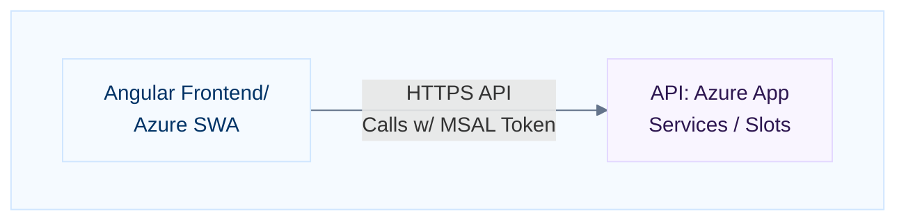
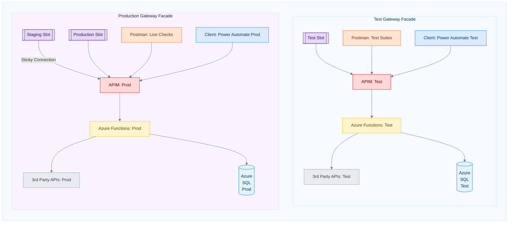
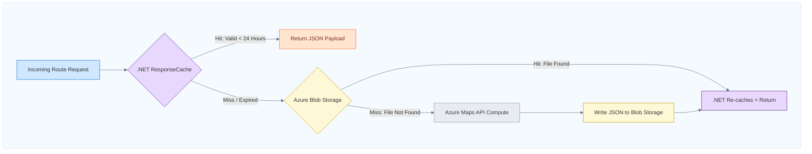

# Freight Logistics Architecture

[View Presentation (Google Slides)](https://docs.google.com/presentation/d/1kNZ3qS8HAFMV5cAThZ2DTC5mIsrtjFAQ/edit?usp=sharing&ouid=103726539775453085274&rtpof=true&sd=true)

---

## Systems Modernization & Architectural Optimization
### **Presenter:** Adrian Forbes (Team Lead, Full Stack Engineering) | Solution Architect Senior

---

## 1a. System Overview & Non-Functional Requirements (NFRs)

- **Business Context:** Mission-critical freight logistics web application for over 200 users (carrier reps, sales, and trackers) and third-party logistics partners
- **Hosting Model:** Fully managed, cloud-native Azure ecosystem
- **Service Level Objectives (SLOs):**
    - Critical North America 14-hour business hours uptime
    - Immediate rollback response for release edge case scenarios
    - Perceived page load times (eg. "Loading...") under 5 seconds with sub-second latency for component asynchronous requests

---

## 1b. System Overview & Non-Functional Requirements (NFRs)

- **Recovery Time Objective (RTO):** Maximum 30 minutes allowable downtime for restoring operations after a disruption or outage
- **Capacity Allocation Constraints:** Acting as both Full Stack Software Engineer and Solution Architect
    - **High Priority (90%)** Ongoing development release cycle and tier-2 support
    - **Medium Priority (10%)** Architectural enhancements, technology upgrades (Angular and .Net), mitigating technical debt (eg. VB.Net repositories)

---

## 2. Legacy Architectural Pain Points

- **High-Risk Promotions:** Had only a Test and Production environment. Slot swaps were executed *between* Test and Production directly, with no Staging layer for validation.
- **Monolithic Complications:**
    - **Combined UI and API Deployment Package:** Build/publish cycles took at least 10 minutes and would sometimes fail, causing additional development downtime.
    - **3rd-party API Lag:** API calls were fired straight from the application runtime, stalling user interfaces when external systems lagged.
- **Severe Memory & Database Pressure:**
    - **No Caching Layer:** Typeaheads relied on a preloaded city-list object held entirely in API server memory and high network/database utilization for customer and carrier dropdowns. Bulky Order/Loads/Tracking pages had slow load times.
    - **Storage Exhaustion:** Multi-city GPS coordinate paths sat inside a bloated database table. No partitioning on `AuditLogs` resulted in query timeouts.
    - **No Storage Offloading:** No document management engine or file storage was utilized.

---

## 3. Legacy Topology

 ```mermaid
%%{init: {
  'theme': '',
  'themeVariables': {
    'fontFamily': 'Arial, sans-serif',
    'fontSize': '15px',
    'primaryColor': '#f8fafc',
    'primaryTextColor': '#0f172a',
    'primaryBorderColor': '#cbd5e1',
    'lineColor': '#64748b',
    'secondaryColor': '#f1f5f9',
    'tertiaryColor': '#ffffff'
  }
}}%%
graph LR
    style Environment fill:#F5FAFF,stroke:#D0E6FF,color:#003366;
    style Data fill:#F3FCF9,stroke:#D1F2EB,color:#0E6251;

    classDef app fill:#E9D8FD,stroke:#5C2D91,color:#2D1650;  %% Light Azure purple
    classDef sql fill:#E0F3FF,stroke:#0078D4,color:#003366;  %% SQL light blue

    subgraph Environment [App Service / Hosting Environment]
        Test[Test Slot<br/>Monolith<br/>UI / API]:::app
        Prod[Prod Slot<br/>Monolith<br/>UI / API]:::app
        
        %% Swap Action
        Test <--> |Deployment Swap| Prod
    end

    subgraph Data [Data Tier]
        DB_Test[(Azure SQL<br/>Test)]:::sql
        DB_Prod[(Azure SQL<br/>Prod)]:::sql
    end

    %% Database Connections
    Test ---> DB_Test
    Prod ---> DB_Prod
```
---

## 4. Decoupled Multi-Environment Topology

 ```mermaid
%%{init: {
  'theme': '',
  'themeVariables': {
    'fontFamily': 'Arial, sans-serif',
    'fontSize': '15px',
    'primaryColor': '#f8fafc',
    'primaryTextColor': '#0f172a',
    'primaryBorderColor': '#cbd5e1',
    'lineColor': '#64748b',
    'secondaryColor': '#f1f5f9',
    'tertiaryColor': '#ffffff'
  }
}}%%
graph LR
    style Container fill:#F5FAFF,stroke:#D0E6FF,color:#003366;
    style Frontend fill:#F5FAFF,stroke:#D0E6FF,color:#003366;
    style Backend fill:#F9F5FF,stroke:#E3D8FF,color:#2D1650;
    style DataStorage fill:#F3FCF9,stroke:#D1F2EB,color:#0E6251;

    classDef swa fill:#CFE8FF,stroke:#0078D4,color:#003366;  %% Light Azure blue
    classDef app fill:#E9D8FD,stroke:#5C2D91,color:#2D1650;  %% Light Azure purple
    classDef sql fill:#E0F3FF,stroke:#0078D4,color:#003366;  %% SQL light blue
    classDef blob fill:#FFF8D6,stroke:#C19A00,color:#5A4A00; %% Light Blob yellow

    subgraph Container[ ]
      direction LR

      subgraph Frontend [Angular CDN<br/>Publishing]
          SWA_Test[Test<br/>SWA]:::swa
          SWA_Stag[Staging<br/>SWA]:::swa
          SWA_Prod[Prod<br/>SWA]:::swa
      end

      subgraph Backend [.Net API Swap Chain]
          SWA_Test -->|UI→API| Slot_Test[[Test<br/>Slot]]:::app
          SWA_Stag -->|UI→API| Slot_Stag[[Staging<br/>Slot]]:::app
          SWA_Prod -->|UI→API| Slot_Prod[[Prod<br/>Slot]]:::app
          
          Slot_Test <-->|Promote| Slot_Stag
          Slot_Stag <-->|Deploy| Slot_Prod
      end

      subgraph DataStorage [Data &<br/>Storage<br/>Tier]
          Slot_Test --> DB_Test[(Azure<br/>SQL<br/>Test)]:::sql
          Slot_Test --> Blob_Test[(Blob<br/>Storage<br/>Test)]:::blob
          
          Slot_Stag -->|Sticky<br/>Setting| DB_Prod_Main[(Azure<br/>SQL<br/>Prod)]:::sql
          Slot_Prod -->|Sticky<br/>Setting| DB_Prod_Main:::sql
          
          Slot_Stag -->|Sticky<br/>Setting| Blob_Prod[(Blob<br/>Storage<br/>Prod)]:::blob
          Slot_Prod -->|Sticky<br/>Setting| Blob_Prod:::blob
      end
    end
```

---

## 5. Compute State & Schema Continuity

- **Frontend Delivery:** Angular static web assets are directly published to their respective Azure SWA instances. No slot switches are performed on the CDN edge.
- **Backend Zero-Downtime Swaps:** API code is published to the **Test Slot** and fully warmed up via the root runtime path, followed by sequential slot swaps to **Staging** and then to **Production** with zero traffic interruption.
- **Database Drift Logic:** Employing an **Expand and Contract pattern**. Schema migrations are pushed *before* the slot swap occurs using backward-compatible, non-breaking mutations.

---

## 6. Existing End-to-End Enterprise Identity & Security

- **Frontend Authentication:** Angular integrates **MSAL (Microsoft Authentication Library)** to handle secure user authentication directly via Microsoft login.
- **The Token Lifecycle:**
    - MSAL acquires and automatically caches cryptographic JWT Access Tokens in the browser.
    - An internal HTTP interceptor attaches the token to all direct backend API requests.
- **Backend Authorization:** The `.NET Web API` validates the incoming Bearer token claims against **Azure Entra ID** to enforce granular Role-Based Access Control (RBAC).



---

## 7. Third-Party API Communication & Dual-Facade Architecture



---

## 8. Database Tuning & Cloud Cost Controls

To prevent unbounded data growth and optimize compute costs within Azure SQL, the database tuning strategy deploys two lifecycle architectures:

- **Horizontal Table Partitioning:**
    - High-volume `AuditLogs` are partitioned by **date ranges**.
    - Query engines leverage **partition pruning** to completely bypass irrelevant data blocks.
    - Result: Sub-second user access to historic compliance trails.
- **Time-Bounded Log Retention:**
    - System telemetry and API `UsageLogs` are capped on a rolling retention window.
    - An automated background process continuously purges aged records.
    - Result: Hard-caps database file size growth and flattens Azure storage expenses.

---

## 9. Comprehensive 4-Tier Caching Topology

To aggressively maximize performance, caching layers are partitioned by data change frequency:

| Tier | Caching Engine | Targeted Data Payload | Lifespan / Isolation Strategy |
| :--- | :--- | :--- | :--- |
| **1** | `.NET ResponseCache` | Long-term Static Lookups | Completely local in-memory; zero network hops. |
| **2** | `Azure Cache for Redis` | High-frequency Typeahead Search | Prefixed key spaces (`prod:typeahead:*`). |
| **3** | Hybrid Response/Blob | Multi-City Route GPS Data | 24-Hour cache fallback to JSON objects. |
| **4** | Azure Blob Storage | Historical Document Archive | Persisted behind authenticated API proxies. |

---

## 10. Tiered Route Resolution Pipeline

When a user requests multi-city route GPS coordinates, the Web API processes the request through a strict **3-tier failover lifecycle**:



---

## 11a. Architectural Performance Gain

| Architecture Optimization | User/Developer Experience | Baseline Range | Optimized Range | Performance Gain |
| :--- | :--- | :--- | :--- | :---: |
| **`.NET ResponseCache`** | Heavy Order/Loads Page | 10-15sec | 2-3sec | 5x |
| **Redis Cache** | City/Customer/Carrier Typeahead (eg. Ch, Chi, Chic) | 1-30sec | 110-120ms (w/u) & 48-51ms (cached) | 9x |
| **Hybrid Response/Blob** | Multi-City Route | 3-5sec | 400-500ms (w/u) & 9-10ms (cached) | 30x |
| **Third-Party Integration** | Push Order & Load Updates on Save | 2sec - timeout | 0sec | 100% |

---

## 11b. Architectural Performance Gain

| Architecture Optimization | User/Developer Experience | Baseline Range | Optimized Range | Performance Gain |
| :--- | :--- | :--- | :--- | :--- |
| **Table Partitioning** | Audit Trail View | 30sec - timeout | 1-3sec | 30x |
| **Decoupled Multi-Environment (UI)** | Build & Publish UI to Test | 10-30min (periodic failure) | 1-2min | 10x (20x for one failure) |
| **Decoupled Multi-Environment (API)** | Build & Publish API to Test | 10-30min (periodic failure) | 2-3min | 5x (10x for one failure) |

---

## 12. Service Cost Line Items

| Service | Change in Tier/Scale/Usage | Delta ($/mo) |
| :--- | :--- | ---: |
| **Application Service** | Service Plan reduced: Premium v3 P2v3 to P1v3 | ($255) |
| **Static Web App** | New Service Plan: Standard | $9 |
| **Azure Functions** | Existing Service Plan: Premium v3 P0v3 | $0 |
| **API Management** | Existing Service | $0 |
| **SQL Azure - Prod** | Compute/Storage: **Capped** at 1600 DTU/750GB | $0 |
| **SQL Azure - Test** | Compute/Storage: 1600 DTU/750GB to 400 DTU/250GB | ($1,817) |
| **Azure Cache for Redis** | New Service Plan: Balanced B1 | $51 |
| **Azure Maps** | Reduced API calls | ($100) |
| **Total** |  | ($2,112) |

---

## 13. Financial Executive Summary

| Financial Metric | Project Optimization Value |
| :--- | ---: |
| **Baseline Architectural Cost (4-month average)** | $7,476 / mo |
| **Post-Implementation Cost (4-month average)** | $5,364 / mo |
| **Cost Reductions Achieved (Monthly)** | $2,112 / mo |
| **Empirical Percentage Reduction** | 28.2 % |
| **Annualized Run-Rate Savings:** | $25,344 / yr |

**Legacy Cost Projection:** Prior to optimization, the baseline architecture cost grew from $5,400 to $7,500 over the previous 9 months. Left unchecked, the monthly cost projection was estimated to cross $8,000 within the next 12 months.

**Future Cost Projection:** All services remain at a steady non-growth level. The Azure SQL production database sits at 177gb capacity with 750gb allocated. Growth allowance is at least two years with minimal change in cost.

---

## 14a. Conclusion, Verification Plan, and Observability Strategy

**User Experience:** Feedback was gathered for web application performance confirmation and data validity
- Page load times ("it runs faster")
- Less reported "need to reload the page" experience
- Speed of dropdown typeaheads
- Map routing speed
- Audit log access speed and no longer avoiding that area
- Third-party API call data validity and speed to save related data

---

## 14b. Conclusion, Verification Plan, and Observability Strategy

**Monitoring:**
- **Application Logs:** Reviewing logs continued as before
- **Azure Metrics:** Charts were added to a `Cost Metrics` dashboard for tracking and verifying stability and costs
    - **Daily Costs:** Stacked service costs per day
    - **App Services (split Test/Prod):** CPU, memory, I/O, process, response time, and requests
    - **Azure SQL Databases (split Test/Prod):** DTU, data space, I/O, and sessions
    - **Redis Cache** CPU and memory
    - **Azure Functions (split Test/Prod):** CPU and memory

---

## 15. Q&A and Engineering Appendix

- Open for peer review regarding architectural topology, schema continuity, caching boundaries, and third-party API isolation.
- **Deep dives available in repository:**
    - [Appendix A: Architectural Trade-off Matrix](https://github.com/acforbes/freight-logistics-architecture/blob/main/technical-spec.md)
    - [Appendix B: Slot Configuration Rules (Sticky vs. Swapped App Settings)](https://github.com/acforbes/freight-logistics-architecture/blob/main/technical-spec.md#appendix-b-slot-configuration-rules-sticky-vs-swapped-app-settings)
    - [Appendix C: Detailed Cache Performance Rationale](https://github.com/acforbes/freight-logistics-architecture/blob/main/technical-spec.md#appendix-c-detailed-cache-performance-rationale)
    - [Appendix D: Isolated Testability Framework (APIM/Postman)](https://github.com/acforbes/freight-logistics-architecture/blob/main/technical-spec.md#appendix-d-isolated-testability-framework-apim--postman)
